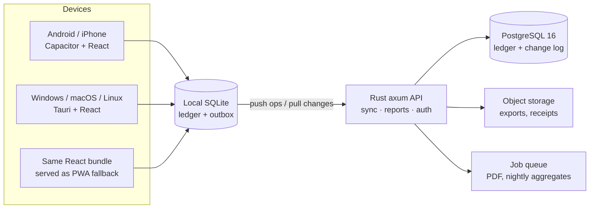

# PRD — Stokku: Aplikasi Inventaris dan Buku Kas Luring untuk Laba Rugi UMKM yang Akurat

| | |
|---|---|
| **Version** | 0.1 (draft) |
| **Date** | 24 Nov 2026 |
| **Owner** | Product (PRDTASK) |
| **Audience** | Founders, engineering, design |
| **Status** | Draft for review — decision points marked **[DECIDE]** |
| **Companion doc** | `TASKS.md` (milestones, backlog, estimates) |

---

## Judul dan SDGs

*Diratifikasi 26 November 2026 oleh PRDTASK (Product) atas penugasan Captain. Sumber usulan: `JUDUL_DAN_SDGS_STOKKU.md` dari writer; klaim SDG di bawah sudah dicocokkan dengan Metadata Indikator TPB/SDGs Indonesia (Bappenas).*

**Judul terpilih:**

> **Stokku: Aplikasi Inventaris dan Buku Kas Luring untuk Laba Rugi UMKM yang Akurat**

**Judul formal (sampul laporan):**

> **Stokku: Rancang Bangun Aplikasi Inventaris dan Buku Kas Berbasis Luring untuk Meningkatkan Ketepatan Perhitungan Laba Rugi Usaha Mikro, Kecil, dan Menengah di Indonesia**

**Pemetaan SDGs.** Tingkat klaim: **Inti** = produk adalah instrumen langsung; **Pendukung** = kontribusi nyata tetapi tidak langsung; **Konteks** = hanya untuk segmen tertentu dan belum terukur.

| SDGs | Nama resmi (Bappenas) | Tingkat | Target | Dasar klaim |
|---|---|---|---|---|
| **8** | Pekerjaan Layak dan Pertumbuhan Ekonomi | **Inti** | 8.3, 8.10 | Laba rugi dan riwayat transaksi yang bisa diekspor menjadi bukti kelayakan kredit UMKM (F-07, F-09, F-13) |
| **10** | Mengurangi Kesenjangan | Pendukung | 10.2 | Bahasa Indonesia, luring, ponsel 2 GB, aksesibilitas 4,5:1 (F-11, F-12, T-505) |
| **1** | Tanpa Kemiskinan | Pendukung | 1.4, 1.5 | Riwayat laba untuk keuangan mikro; opname dan laporan stok mengurangi kebocoran modal (F-05, F-10) |
| **9** | Industri, Inovasi, dan Infrastruktur | Pendukung | 9.3 | Menurunkan biaya digitalisasi usaha kecil, tetapi tidak menyediakan kredit maupun integrasi rantai nilai |
| **4** | Pendidikan Berkualitas | Pendukung (lemah) | 4.4 | Panel penjelasan dan artikel bantuan; indikator 4.4 mengukur keterampilan TIK, bukan literasi laba rugi |
| **12** | Konsumsi dan Produksi yang Bertanggung Jawab | Konteks | 12.3, 12.5 | Stok mati dan opname menekan pembelian berlebih; 12.3 khusus limbah pangan, jadi hanya segmen makanan |
| **5** | Kesetaraan Gender | Konteks | 5.a | Tidak ada fitur khusus gender; 5.a tentang hak atas tanah, sehingga kaitannya tidak langsung dan tidak boleh diklaim sebagai target terukur |

**Koreksi terhadap usulan writer** (dicatat agar tidak diwariskan sebagai klaim berlebih):

1. **SDG 9 diturunkan dari "pendukung kuat" menjadi "pendukung".** Target 9.3 berbunyi *"Meningkatkan akses industri kecil dan usaha lainnya … terhadap jasa keuangan, termasuk kredit terjangkau, dan integrasi mereka ke dalam rantai nilai dan pasar."* Produk ini tidak menyalurkan kredit dan tidak mengintegrasikan rantai nilai; yang disumbangkan hanya penurunan biaya dan hambatan digitalisasi. Klaim "kuat" tidak tertopang rumusan resmi target.
2. **Nama resmi SDG 10 adalah "Mengurangi Kesenjangan"** (Bappenas), bukan "Berkurangnya Kesenjangan". Keduanya beredar, tetapi dokumen ini memakai bentuk Bappenas.
3. **SDG 4 dan 5.a tetap ada, tetapi batas klaimnya ditulis eksplisit.** 4.4 mengukur keterampilan TIK/kejuruan, sedangkan produk ini mengajarkan literasi laba rugi; 5.a tentang hak perempuan atas tanah dan sumber daya ekonomi, bukan fitur perangkat lunak. Keduanya tidak boleh dipakai sebagai target terukur sampai data beta (T-515) tersedia.
4. **SDG 2, 3, 6, 7, 11, 13, 14, 15, 16, dan 17 tidak diklaim.** Tidak ada fitur di PRD/TASKS yang menopang targetnya secara langsung.

Indikator resmi SDGs diukur di tingkat nasional. Stokku hanya menyumbang melalui proksi tingkat toko — misalnya persentase toko yang membuka laba rugi bulanan, kelengkapan riwayat transaksi, dan selisih opname — dan tidak mengklaim pergerakan indikator nasional.

---

## 1. Summary

A simple bookkeeping app for Indonesian micro and small businesses (UMKM) — warungs, toko, laundry, katering, bengkel — that tracks **stock in/out**, **money in/out**, and turns both into a **real profit-and-loss (laba rugi)** number without accounting knowledge. Built for Indonesia: Bahasa Indonesia, IDR, WIB/WITA/WIT, and **QRIS** at the point of payment.

Runs on Android, iPhone, Windows, macOS, and Linux from one codebase. Works offline. Backend in Rust, PostgreSQL, frontend in React.

**The one-sentence pitch:** *"Your notebook, but it tells you your real profit."*

---

## 2. Problem

UMKM owners typically run on a paper book, a WhatsApp chat with their supplier, and Excel on a laptop that has a broken hinge. Three things break:

1. **Stock truth.** Physical stock never matches the book. Owners discover a discrepancy during a stock opname (if they ever do one) and cannot find where it went.
2. **Profit illusion.** Cash in the drawer feels like profit. Money already spent on stock, unpaid supplier bills, and unpaid customer debts (piutang) are invisible, so a "profitable" month can end with no money.
3. **Cost of admin.** Recapping by hand takes an evening per week, so it stops happening, so the numbers stop being trusted, so the book is abandoned — usually within 2–3 months.

Existing options fail in predictable ways: full accounting suites (Accurate, Jurnal) are too heavy and assume accounting literacy; POS apps optimise for food-service menus rather than stock; Excel templates break on a phone and die when the file goes missing.

**The wedge:** the smallest usable mental model. Two ledgers — *barang* and *uang* — and one report that everyone actually wants: *did I make money this month?*

---

## 3. Goals and non-goals

### Goals (MVP)

| # | Goal | Measure |
|---|---|---|
| G1 | A new shop records its first stock-in within 10 minutes of installing, with no tutorial | ≥ 80% of signups reach first stock-in in a test cohort |
| G2 | Owner gets a correct laba rugi for a chosen month in ≤ 2 taps | ≥ 60% of weekly-active shops open a report weekly |
| G3 | Works with no signal, on a 2 GB RAM Android phone | Full core flow offline; sync < 5 s for 50 ops on 3G |
| G4 | Same account usable on phone and laptop | ≥ 25% of shops use ≥ 2 devices |
| G5 | Numbers are explainable | Every report line drills down to the transactions that made it |

### Non-goals (MVP)

- Full double-entry accounting, journal entries, general ledger, balance sheet.
- Payroll, tax filing (e-Faktur), manufacturing/BOM, restaurant table & kitchen flow.
- Multi-currency. Everything is IDR.
- Online storefront / marketplace sync (Tokopedia, Shopee) — later.
- Public API for third parties.
- Website marketing site (separate, not in scope here).

> **Scope discipline:** if a feature does not serve G1–G5, it is not MVP. The classic failure of this product category is shipping a mediocre ERP. We ship a sharp ledger.

---

## 4. Personas

**P1 — Bu Sri, 41, warung kelontong, Surabaya.** Android mid-range, prepaid data, sells ~900 SKUs. Does the book at 21:00 after closing. Cares about: stock running out, siapa yang belum bayar (who owes her), and whether the month was actually good. Tech comfort: WhatsApp, GoPay, YouTube. Will not read documentation.

**P2 — Pak Andi, 29, katering, Bandung.** Windows laptop in the kitchen, Android phone for orders. Buys ingredients per event. Cares about: cost per event, waste, and whether a catering job was worth taking. Comfortable with Excel; expects keyboard entry to be fast.

**P3 — Rina, 23, kasir/staff.** Uses the owner's device or her own phone. Must not see profit, cost prices, or owner's cash entries. Needs the fastest possible "barang keluar" flow with a barcode scan.

**P4 — Owner with 2 outlets (V1+).** Wants per-outlet stock and consolidated profit, and to move stock between outlets.

Design consequences: big tap targets, one primary action per screen, Bahasa Indonesia first, no accounting jargon on the surface, optimistic UI (never a spinner where a number can be shown instantly), and a hard permission line between "operation" and "money".

---

## 5. Jobs to be done

| JTBD | Today | With product |
|---|---|---|
| "When stock arrives, I want to record it before I forget, so my stock count stays right." | Notebook, later | Scan/search item → qty → save, 3 taps, offline ok |
| "When I sell, I want stock to go down without extra work." | Nothing | Sale entry deducts stock automatically |
| "At month end I want to know my profit, not just my cash." | Guess | Laba rugi with HPP, opex, piutang/utang shown |
| "When something doesn't add up, I want to find the mistake." | Re-count everything | Ledger per item with who/when/why |
| "When I buy from a supplier on credit, I want to remember to pay." | Memory | Utang list with due dates |
| "When a customer owes me, I want to chase them." | WhatsApp memory | Piutang list, shareable reminder text |
| "When my phone dies or I change phones, I want my data." | Lost | Server sync + export |

---

## 6. Scope by release

### MVP (v0.1) — single outlet, single owner + optional staff

| ID | Feature | Notes |
|---|---|---|
| F-01 | Signup, login, business setup | Email + password. Business name, outlet, currency fixed to IDR, tax rate configurable (default off) |
| F-02 | Item catalog | SKU/name/barcode, category, unit + unit conversions (pcs/dus/kg), sale price, cost, min stock, active flag |
| F-03 | Stock in | Receive stock; records qty, unit cost, supplier (free text), date; updates moving-average cost |
| F-04 | Stock out | Sale, loss/damage, return to supplier, correction |
| F-05 | Stock opname | Count sheet per category → variance → adjustment entry with reason |
| F-06 | Barcode scan | Camera scan (EAN/UPC/Code128) + manual search; BT scanner acts as keyboard |
| F-07 | Sales record | Line items, price, qty, discount, payment method, paid/unpaid; deducts stock; optional receipt share |
| F-08 | Cash book | Kas masuk / kas keluar with categories, method, note; links to sales/purchases optional |
| F-09 | Laba rugi report | Revenue − HPP − operating expenses = net profit, per month/period, drill-down |
| F-10 | Stock reports | Current stock, stock value, low stock, dead stock, movement history |
| F-11 | Offline-first + sync | Full core flows offline; queued writes; visible sync state |
| F-12 | Roles & audit | Owner / Staff; staff cannot see cost or profit; every write logged |
| F-13 | Export & backup | CSV per report, PDF/WhatsApp share, full data export (owner's data, owner's right) |
| F-14 | QRIS payment display | Show the outlet's own QRIS code at checkout, confirm manually, record method + fee. No integration needed (see §7 F-14) |

### V1 (v0.2–0.4) — the "real shop" release

**Dynamic QRIS** (amount pre-filled, auto-confirmed by webhook) · Suppliers & purchases with utang (accounts payable) · Customers & piutang (receivables) with aging · Multi-outlet + stock transfer · Batch & expiry for F&B · Thermal receipt print (58/80 mm, Bluetooth) · Excel import of existing item list · Dashboard KPIs · Discounts & price tiers (grosir/retail) · WhatsApp price list / catalog share · Daily cash close with lock.

### Later / considered

Marketplace sync · e-Faktur export · Multi-PJSP routing (Xendit + Midtrans + Doku) · QRIS CPM (customer shows code) · Double-entry mode for accountants · AI reorder suggestion · Franchise/multi-business billing · Supplier price comparison · Customer loyalty · PWA public catalog.

---

## 7. Functional specifications

Format: behaviour + acceptance criteria. Only MVP features get full specs; V1 items are one-liners above.

### F-01 Authentication & setup

- Signup: email, password (min 8, Argon2id hash), business name. No email verification in MVP (blocks onboarding; add in V1 with a soft banner).
- Session: short-lived access JWT (15 min) + rotating refresh token (30 days) stored in the OS keychain/keystore, not localStorage.
- Setup wizard (skippable, ≤ 4 screens): business name → type of business (sets suggested categories) → tax on/off + rate → opening stock (optional "I already have stock" quick add).
- **AC:** A user can complete setup and add the first item in under 3 minutes on a phone. Setup is resumable if the app is killed.

### F-02 Item catalog

- Fields: name, SKU (auto-generated, editable, unique per tenant), barcode (optional, unique per tenant, multiple allowed), category (flat list, user-editable), base unit, extra units with conversion factor (1 dus = 24 pcs), sale price, default cost, min stock, active.
- Stock is always stored in the **base unit**; display converts.
- Soft delete only; deleting an item with movement history is refused with an explanation.
- **AC:** Search matches name, SKU, or barcode, case- and accent-insensitive, results in < 100 ms for 5,000 items locally.

### F-03 / F-04 Stock movements

- One immutable `stock_move` row per event: item, outlet, qty delta, unit cost at the time, type (`in | sale | loss | return | adjust | transfer`), reference (sale/purchase/opname id), business date, actor, note.
- Corrections are **reversals**, never edits. Editing a posted movement creates a counter-entry plus a new entry, both visible in history.
- Stock in with a unit cost updates the item's moving-average cost.
- Negative stock: **allowed but flagged** (real shops sell before recording receipts). Configurable warning; blocking is off by default because blocking loses sales.
- **AC:** Item ledger shows a running balance that always equals sum of deltas. Reversal of an in-movement after stock was sold is allowed, with a warning about cost impact.

### F-05 Stock opname

- Create a session (all items, or one category), enter counted qty per item, system shows system qty and variance, then post one adjustment per non-zero variance in a single transaction.
- **AC:** Opname is atomic — either all variances post or none. Session history keeps the original counts forever.

### F-06 Barcode scan

- Camera scan on Android/iOS; graceful permission-denied path with manual entry always available.
- Hardware Bluetooth/USB scanners work as keyboard input into any search field, with a "scan mode" that auto-submits on Enter.
- **AC:** Scan → item found in < 1 s in good light; unknown barcode offers "create new item with this barcode".

### F-07 Sales

- A sale is a list of (item, qty, unit price, discount) plus payment method (`cash | transfer | qris | credit`) and paid flag.
- Posting a sale creates the sale, its lines, one `sale` stock move per line, and a cash entry if paid — atomically, one server transaction / one sync op group.
- Credit sales create a piutang record (V1 surface; MVP stores it, shows it in laba rugi as revenue with a note).
- **AC:** A 5-line sale posts in under 2 s on a low-end phone, offline. Voiding a sale restores stock and marks it void in history, never deletes it.

### F-08 Cash book

- Entries: `in | out`, amount (IDR integer), category (user-editable, seeded: penjualan, modal, bayar supplier, gaji, listrik, sewa, transport, lain-lain), method, business date, note, attachment (photo of receipt, optional, V1 for OCR).
- **AC:** Balance and per-category totals for any period reconcile to the entries list exactly.

### F-09 Laba rugi

```
Pendapatan penjualan            (sum of sales revenue, net of discount)
− HPP                           (sum of qty × moving-avg cost at time of sale)
= Laba kotor
− Beban operasional             (cash out entries tagged as expense, excluding stock purchases)
= Laba bersih
```

- Stock purchases are **not** expenses — they are inventory until sold. This is the single most important accounting distinction in the product, and the report must state it in plain language.
- Period selector: this month / last month / custom range / per year. Comparison to previous period.
- Every line is tappable and lists the contributing transactions.
- Unpaid credit sales appear as revenue with a separate "belum dibayar" note so profit isn't confused with cash.
- **AC:** For any period, `revenue − HPP − opex` equals the report's net profit to the rupiah, and matches a manual recomputation from the ledger.

### F-10 Stock reports

- Current stock & value (qty × moving-avg cost, and × sale price for retail value).
- Low stock (qty ≤ min stock), dead stock (no movement in 60 days, configurable), slow movers.
- Per-item movement history with running balance.
- **AC:** Stock value reconciles to sum of ledger at cost; low-stock list updates immediately after a sale.

### F-11 Offline & sync

Detailed in §9. **AC:** Airplane mode for 30 days, then reconnect, loses nothing and reports the same numbers as the server.

### F-12 Roles

| Capability | Owner | Staff |
|---|---|---|
| Stock in/out, opname, sales, cash in/out | ✓ | ✓ |
| See cost price, HPP, profit | ✓ | — |
| Edit items, prices | ✓ | — (qty only) |
| Reports (money) | ✓ | — |
| Manage users, export, delete business | ✓ | — |
| View own cash entries | ✓ | ✓ |

- Audit log: actor, action, entity, before/after (for master data), timestamp, device.
- **AC:** A staff account cannot reach cost or profit data through any API endpoint, not just hidden UI.

### F-13 Export & data ownership

- CSV export for items, stock, sales, cash, laba rugi. PDF for laba rugi and opname sheet. Share sheet → WhatsApp/email/drive.
- Full account export as a single archive (JSON + CSVs) available to the owner at any time.
- **AC:** Export completes for 50k movements in < 60 s and is downloadable in-app.

### F-14 QRIS payments

Two tiers, deliberately separated, because only one of them can ship on day one.

**Tier 0 — display + confirm (MVP, no integration, no KYC)**

- Per outlet, the owner stores their existing QRIS: either an uploaded image of the static code they already got from their bank or e-wallet (BRI, BCA, GoPay, OVO, ShopeePay merchant, etc.), or a raw QRIS payload string rendered as a QR by the app.
- At checkout, the cashier taps **QRIS** → QR fills the screen at high brightness → customer scans and pays → cashier taps **Sudah dibayar**.
- Records `payment_method = qris`, amount, and an optional MDR percentage (default 0) so the cash book can separate gross from the fee the provider deducts.
- Works while the app is offline (the customer's phone still needs signal to pay; ours does not).
- **AC:** Payment screen opens in < 300 ms from a sale; QR renders scannable at 100% zoom on a 5" screen; a payment recorded offline syncs without duplicates.

**Tier 1 — dynamic QRIS (V1, needs a PJSP merchant account)**

- Generate a per-transaction QRIS with the amount embedded, via a payment partner's API. The QR is valid for a set expiry (typically 5–30 min); status arrives by webhook, so the sale auto-confirms and the cashier does not have to trust the customer's screenshot.
- Fallback when the webhook is late or the device is offline: poll status, then manual confirm — never a dead end at the counter.
- Settlement reconciliation: provider settles T+1/T+2 net of MDR; the app records **gross revenue**, **MDR expense**, and **net received**, so laba rugi is not overstated.
- Refund and void paths must reverse both the sale and the payment.
- **AC:** A dynamic QRIS payment confirms in-app within 5 s of the customer paying; a settlement report reconciles to the provider's dashboard to the rupiah; a failed/timed-out QR expires and leaves the sale usable.

**What we do not do:** we are not a payment aggregator. Funds must land in the merchant's own account under their own agreement with a licensed PJP/PJSP (Bank Indonesia license). Holding or routing other people's money would require a licence we are not seeking. Model: each shop connects its own merchant credentials, or joins as a sub-merchant where the provider supports a platform/sub-account model.

**Offline truth:** QRIS needs the *customer's* connection, not ours. Tier 0 therefore works in a basement; Tier 1 needs ours for the webhook but degrades to Tier 0.

---

## 8. Technical architecture

### 8.1 Stack

| Layer | Choice | Why |
|---|---|---|
| UI | React 19 + TypeScript + Vite | One codebase for 5 platforms; huge hiring pool |
| Desktop shell | **Tauri 2** (Windows, macOS, Linux) | ~10 MB installers vs ~120 MB Electron; Rust-native, reuses the team's Rust skill; small memory footprint on cheap laptops |
| Mobile shell | **Capacitor** (Android, iOS) | Reuses the same web build; mature SQLite, camera, printer plugins; OTA web updates without store review |
| Local DB | SQLite (Tauri SQL plugin / `@capacitor-community/sqlite`) behind one adapter interface | Offline-first with a real query engine, not IndexedDB |
| API | **Rust + axum + sqlx + tokio** | Type-safe, fast, low memory; sqlx compile-time-checked SQL |
| DB | **PostgreSQL 16** (managed) | Relational ledger, window functions for reports, strong constraints |
| Region | **Indonesia / nearest**: AWS `ap-southeast-3` (Jakarta) first choice, Singapore as fallback | Latency < 30 ms from Jakarta; keeps financial data in-country where possible (UU PDP consideration) |
| Payments | **QRIS** via a licensed PJSP (Tier 1 only) — Xendit, Midtrans, Doku, or OY! | Never self-aggregate; see ADR-11 |
| Deploy | **[DECIDE]** — see below | |
| Auth | Argon2id + JWT access + rotating refresh | Standard, no vendor lock-in |

### 8.2 On "serverless" — an honest assessment

The requirement is really *low ops and low cost*, not a specific hosting model. Postgres does not love serverless functions (connection storms), and Rust on Lambda/Workers adds cold-start and build complexity. Recommendation:

- **Build the API as a plain axum binary.** It runs identically on a laptop, a container, or Lambda via `lambda_http`. Portability first, so the hosting decision can be deferred and reversed cheaply.
- **Recommended for launch:** one small container (Fly.io / Railway / Render, shared CPU 256–512 MB) + **Neon or Supabase Postgres** (managed, pooled). Effectively zero-ops, ~US$5–25/month total, no connection-pool problems, no cold starts on the API path that a cashier hits 200 times a day.
- **True serverless alternative if cost must approach zero at idle:** AWS Lambda (arm64, `lambda_http`) + RDS Proxy or Neon pooler; or Cloudflare Workers via `workers-rs` + Hyperdrive (most restrictive: no `tokio` full, no `sqlx` runtime, more glue).
- **Verdict:** container + managed Postgres for MVP; revisit if idle cost matters. Documented as ADR-2 so the choice is a config change, not a rewrite.

**Region.** Jakarta (`ap-southeast-3`) if we run on AWS/RDS — best latency and the cleanest answer for anyone who asks where the data sits. Neon and Supabase have no Jakarta region; Singapore (`ap-southeast-1`) is ~15–25 ms away and acceptable for this workload, but it is **outside Indonesia**, which matters under UU PDP (Law 27/2022) if we ever hold personal data of customers (names, phone numbers, receivables). Practical default: **Singapore at launch, migrate to Jakarta before we store customer PII at scale**, and state the location plainly in the privacy policy rather than quietly.

### 8.3 Diagram



### 8.4 Key decisions (ADRs)

| # | Decision | Rationale | Rejected alternative |
|---|---|---|---|
| ADR-1 | One React UI, two thin shells (Tauri + Capacitor) | 5 platforms, one design system, one bug fix | React Native (two UIs, slower for form-heavy desktop); Flutter (no React reuse) |
| ADR-2 | Portable axum binary, container + managed PG at launch | Avoids serverless PG pain; reversible | Lambda-first (cold starts, sqlx friction), Workers (glue) |
| ADR-3 | Append-only ledgers for stock and money | Conflicts disappear by construction; audit is free | Mutable balances (needs locking, loses history) |
| ADR-4 | Moving weighted average cost (HPP) | One number per item, cheap to compute, what UMKM expects | FIFO (correct for expiry-heavy goods, far more complex), LIFO (not allowed under common practice) |
| ADR-5 | Money as `BIGINT` rupiah; qty as `NUMERIC(14,3)` | IDR has no circulating sub-unit; avoids float error | `NUMERIC` money (fine, heavier), floats (never) |
| ADR-6 | UUIDv7 primary keys | Sortable, generated client-side offline, no ID collision on sync | Serial (blocks offline writes), UUIDv4 (index bloat) |
| ADR-7 | `tenant_id` on every row + Postgres RLS | Defense in depth against the classic cross-tenant leak | App-layer filtering only |
| ADR-8 | Corrections only via reversal | Financial history stays trustworthy | Edit/delete in place |
| ADR-9 | Business date separate from server sequence | Backdated entries matter for reports; ordering must not trust client clocks | Client timestamps as truth |
| ADR-10 | Bahasa Indonesia default, i18n from day 1 | Core market; English for staff/dev later | Hard-coded strings |
| ADR-11 | QRIS through a licensed PJSP, merchant-owns-the-account | We cannot hold or route merchant funds without a Bank Indonesia licence; sub-merchant/platform model where supported | Becoming an aggregator (regulatory wall), direct BI integration (not available to us) |
| ADR-12 | Static-QRIS display in MVP, dynamic QRIS in V1 | Ships value in days with zero KYC or provider approval; dynamic adds auto-confirm but needs a merchant account per shop | Waiting for dynamic QRIS before launch (delays launch by weeks of paperwork) |
| ADR-13 | Singapore for MVP, Jakarta when customer PII arrives | Latency and data-residency under UU PDP | Jakarta from day one (fewer managed-PG options, higher cost) |

### 8.5 Data model (core tables)

```
tenant(id, name, tax_rate, created_at)
outlet(id, tenant_id, name, address, timezone,      -- Asia/Jakarta | Makassar | Jayapura
       qris_mode,                                    -- none | static_image | static_payload
       qris_image_key, qris_payload, mdr_pct)
user(id, email, password_hash, name, created_at)
membership(id, tenant_id, user_id, role)            -- owner | staff
device(id, user_id, name, platform, last_seen_at)

item(id, tenant_id, sku, name, category_id, base_unit,
     sale_price, cost_avg, min_stock, active, updated_at)
item_barcode(id, item_id, barcode)
item_unit(id, item_id, name, factor)                 -- 1 dus = 24 pcs
category(id, tenant_id, name, sort)

stock_move(id, tenant_id, outlet_id, item_id, qty, unit_cost,
           type, ref_type, ref_id, business_date, note,
           created_by, created_at, op_id, server_seq)
stock_level(tenant_id, outlet_id, item_id, qty)      -- maintained projection

sale(id, tenant_id, outlet_id, number, customer_id?, total,
     discount, payment_method, paid, business_date, voided_at, op_id)
sale_line(id, sale_id, item_id, qty, unit_price, discount, cost_at_sale)

payment(id, tenant_id, sale_id, method,            -- cash | qris | transfer | card
        provider,                                   -- null | xendit | midtrans | doku | oy
        amount_gross, mdr_amount, amount_net,
        status,                                     -- pending | paid | expired | refunded
        provider_ref, qr_string, expires_at,
        paid_at, settlement_id, confirmed_by)       -- confirmed_by = user for Tier 0
settlement(id, tenant_id, provider, period_start, period_end,
           gross, fees, net, received_at)

cash_entry(id, tenant_id, outlet_id, direction, amount, category,
           method, ref_type, ref_id, business_date, note, op_id)

contact(id, tenant_id, type, name, phone)             -- customer | supplier
payable(id, tenant_id, contact_id, amount, due_date, paid_amount)
receivable(id, ...)                                   -- mirrors payable

op_log(op_id, tenant_id, device_id, applied_at, result)  -- idempotency
change_log(server_seq, tenant_id, table_name, row_id, op) -- sync cursor
audit_log(id, tenant_id, actor_id, action, entity, before, after, at)
```

Reports are SQL views over `stock_move`, `sale_line`, `cash_entry` — no separate reporting store in MVP.

---

## 9. Offline-first and sync protocol

This is the highest-risk part of the build; it gets its own spec.

**Principles**

1. The device is the source of truth for *user intent*; the server is the source of truth for *ordering and totals*.
2. Writes are operations, not row states. Each op is immutable, carries a client-generated UUIDv7 `op_id`, and is applied exactly once (unique index on `op_log.op_id`).
3. Append-only entities (`stock_move`, `cash_entry`, `sale`) cannot conflict — two devices adding a sale simply both add sales.
4. Only master data (items, categories, settings) can conflict → last-write-wins per row using the **server** clock, with a "changed on another device" notice when a stale edit is overwritten.

**Push**

```
POST /v1/sync/push
{ device_id, ops: [ { op_id, type, payload, client_ts } ] }   // max 50
→ 200 { results: [ { op_id, status: "applied" | "duplicate" | "rejected", reason? } ],
        cursor: 88421 }
```

Applied inside a single DB transaction per batch, ordered by `client_ts` then `op_id`. Database constraints do the validation (stock non-negative policy, price ≥ 0, period not closed).

**Pull**

```
GET /v1/sync/pull?cursor=88421&limit=500
→ 200 { changes: [ { table, row, server_seq } ], cursor: 88940, has_more: false }
```

**Client rules**

- Outbox is persisted in SQLite; the UI reads only from local tables (single source of render), so the screen never flickers between local and server state.
- Sync triggers: app foreground, network regained, after each mutation (debounced 1 s), background every 15 min on mobile.
- Sync state is visible but quiet: a small dot (synced / pending / error + count). Never a blocking modal.
- Conflict and rejection surface as an "Perlu dicek" inbox item, not a lost write.
- Rows written **by the server** (QRIS webhook confirming a payment, a settlement import) reach devices through the same `change_log` → pull path. The client must never assume it authored every row it sees, and must not clobber a server-set `paid` flag with a stale local one.

**What we deliberately do not build:** CRDTs, peer-to-peer sync, real-time collaboration. All are overkill for one shop with 1–3 devices.

**Closed periods:** a daily cash close (V1) or monthly lock; backdated ops into a closed period are rejected and routed to the owner for approval.

---

## 10. Non-functional requirements

| Area | Requirement |
|---|---|
| Performance | Cold start < 2 s (mobile p95); local list scroll 60 fps at 5k items; API p95 < 300 ms; sync 50 ops < 5 s on 3G |
| Scale (MVP) | 50k items, 1M stock moves per tenant; 10k tenants; design for 100× before re-architecting |
| Devices | Android 8+ (2 GB RAM, 5" screen), iOS 15+, Windows 10+, macOS 12+, Ubuntu 22.04+; responsive 360 px → 2560 px |
| Offline | 30 days of full offline operation; no data loss on crash (local WAL) |
| Durability | Server PITR ≥ 7 days, nightly logical backup to object storage, quarterly restore drill |
| Security | TLS everywhere, Argon2id, refresh-token rotation + reuse detection, RLS, rate limits on auth, no secrets in the client bundle |
| Privacy | Financial data is sensitive: no ad SDKs, no third-party analytics with payloads, opt-in crash reporting, documented retention, owner-triggered deletion |
| Accessibility | Contrast ≥ 4.5:1, ≥ 44 px touch targets, full keyboard nav on desktop, screen-reader labels on the cash flow |
| Localisation | Bahasa Indonesia default, English secondary; IDR formatting `Rp1.234.567`; `Asia/Jakarta` default with per-outlet timezone |
| Availability | 99.5% target for MVP (one region); graceful offline means downtime is not data loss |
| Payments | QRIS QR render < 300 ms; webhook confirmed < 5 s p95 after provider callback; settlement reconciliation daily; no payment state may be lost on a crash |
| Compliance | UU PDP (Law 27/2022): documented purpose, consent, retention, deletion on request; data location stated in policy; PJP/PJSP terms respected for QRIS; no card data ever touches our servers (redirect/QR only, no PAN) |
| Indonesia specifics | WIB/WITA/WIT per outlet; `+62` phone normalisation; `Rp` formatting; QRIS and e-wallet as first-class methods alongside cash |

---

## 11. Analytics (privacy-respecting, aggregate)

Core funnel: install → setup complete → first item → first stock-in → first sale → first report opened → week-2 return.

Product health: % shops with ≥ 1 sync per active day · sync error rate (< 0.1% of ops) · median ops/day per shop · report open rate · % days with a full cash close · D7/D30 retention · support tickets per 100 shops.

North star candidate: **weekly shops that post a laba rugi and a stock opname** — proof the habit formed, not just the download.

---

## 12. Risks

| Risk | Impact | Mitigation |
|---|---|---|
| Sync bugs corrupt or duplicate stock | Existential (trust) | Append-only + idempotency keys; property-based tests; shadow-mode reconcile job comparing client vs server totals nightly |
| Scope creep toward full ERP | Misses the market window | Non-goals list is contractual; V1 gate requires MVP retention data |
| Users don't adopt because entering stock is tedious | No data → no value | Barcode, quick-add, voice-free 3-tap flow, Excel import in V1, "opening stock in 5 minutes" onboarding |
| Low-end devices choke | Churn | Local pagination, virtualised lists, no heavy charts, bundle budget < 300 KB gz |
| iOS review + $99/yr + no sideloading | Cost/velocity | iOS last in the shell work; Android + Windows first for beta |
| Thermal printer fragmentation | Support burden | Support only ESC/POS 58/80 mm via OS print dialog first, Bluetooth later |
| Numbers distrusted ("kok beda?") | Abandonment | Drill-down on every figure, plain-language explanation, visible ledger |
| Single founder + Rust learning curve | Delay | Rust only where it pays (API); keep the client in TypeScript |
| QRIS provider onboarding (KYC) drags or is refused | Dynamic QRIS slips past V1 | Static QRIS ships in MVP regardless; open merchant accounts with two providers in parallel on day 1 |
| Missed or duplicated payment webhook | Wrong "paid" state, duplicate revenue | Idempotency on `provider_ref`, status-poll fallback, manual confirm escape hatch, daily reconciliation |
| MDR and T+1 settlement mismatch | Profit looks wrong, support tickets | Store gross / fee / net separately; reconcile against the provider dashboard daily |
| Regulator view: are we aggregating funds? | Licence risk | ADR-11 — merchant-owns-account, no fund custody, legal review before Tier 1 |
| Data residency expectation from shops | Trust / compliance | State location in policy; Jakarta migration path defined (ADR-13) |

---

## 13. Rollout

| Stage | Gate |
|---|---|
| Internal alpha (dev + 2 friendly shops) | Core flows work; zero data loss over 2 weeks; static QRIS shown and confirmed at checkout |
| Closed beta (20–30 shops, Android + Windows) | G1 met, sync error < 0.5%, no P1 bugs |
| Public beta (ID Play Store + Windows installer) | G1–G3 met, crash-free sessions > 99.5% |
| v1.0 | 4 weeks of stable beta, piutang/utang shipped |
| Dynamic QRIS (separate gate) | Sandbox pass → one real shop for 2 weeks → settlement reconciles to the rupiah before general release |

Distribution: Google Play, Apple App Store, signed Windows MSI/NSIS, `.dmg` (notarised), AppImage/deb for Linux, plus a read-only PWA for "just look at my report".

**Cost estimate (verify current pricing before committing):** hosting + managed Postgres ≈ US$5–25/mo at MVP scale, object storage pennies, Play Store US$25 once, Apple US$99/yr, domain ~US$12/yr. **QRIS MDR is passed through per transaction, not a fixed cost** — commonly quoted around 0.7% of QRIS volume, with micro-merchant schemes that can differ; confirm the applicable rate and any exemption with the chosen PJSP before modelling margin. Marketing spend excluded.

---

## 14. Open questions

1. **[DECIDE] Is a sale always a POS transaction, or is it a daily "total penjualan" entry?** A daily lump sum is far simpler and probably enough for a warung, but it cannot deduct per-item stock. Recommendation: support both — per-item sales for shops that scan, and a daily total mode that deducts nothing but records revenue. This choice changes F-07 substantially.
2. **[DECIDE] Single outlet at launch, or multi-outlet from day one?** Recommendation: single, with the schema ready (outlet_id everywhere).
3. **[DECIDE] Do we need to print receipts in MVP?** Recommendation: share as image/PDF to WhatsApp instead; thermal printing in V1.
4. Do we support staff logins in MVP or later? Recommendation: MVP, because staff data entry is the actual daily use.
5. Which business verticals get seeded category templates at launch? Recommendation: kelontong, katering, laundry, bengkel, fashion.
6. **[DECIDE] Which PJSP for dynamic QRIS?** Recommendation: Xendit (strong sub-account/platform model, good docs) or Midtrans (largest merchant base in ID). Decide before V1 sprint 1 because KYC takes calendar time, not dev time.
7. **[DECIDE] Does the shop already have QRIS, or should we help them get it?** If most already have a static code, Tier 0 is enough and Tier 1 is a convenience. If they don't, a "get QRIS in the app" onboarding flow becomes a real feature and a partnership conversation.
8. Data residency: is Singapore acceptable at launch, or must data sit in Jakarta from day one? Recommendation: Singapore now, migrate before storing customer PII (ADR-13).

---

## 15. Glossary

**UMKM** — usaha mikro, kecil, dan menengah; Indonesian MSMEs. **HPP** — harga pokok penjualan, cost of goods sold. **Laba rugi** — profit and loss. **Opname** — physical stock count. **Piutang** — money customers owe you. **Utang** — money you owe suppliers. **Moving average cost** — item cost recalculated on each purchase. **Ledger** — append-only list of movements. **Serverless** — running code without managing servers. **RLS** — Postgres row-level security. **Idempotent** — repeating an operation has no extra effect.

**QRIS** — Quick Response Code Indonesian Standard, the national interoperable QR payment standard set by Bank Indonesia; one code readable by any bank or e-wallet app. **PJP / PJSP** — the licensed payment service providers that may legally process QRIS; we integrate, we do not become one. **MDR** — merchant discount rate, the fee the provider keeps per transaction. **Settlement** — the provider paying the merchant later (T+1/T+2), net of MDR. **UU PDP** — Indonesia's personal data protection law (No. 27/2022).